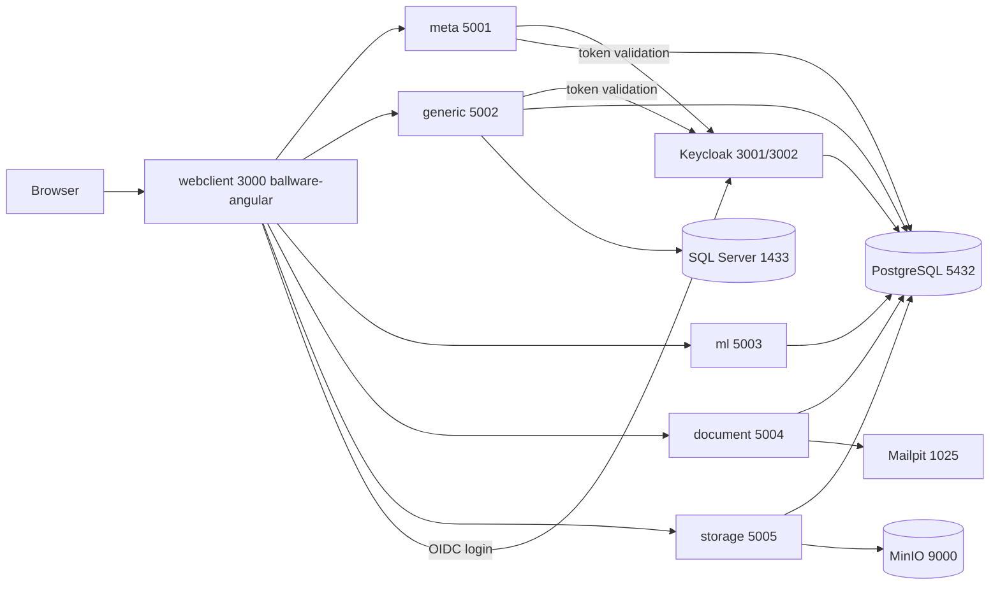
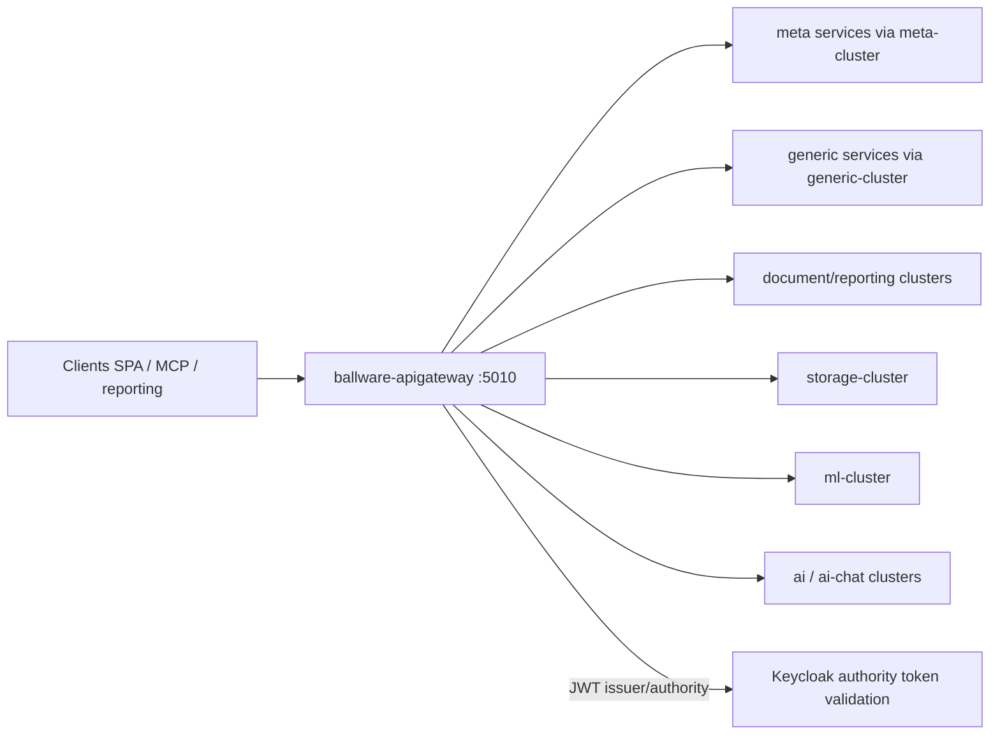

# Architecture

The reference topology documented here is the **Docker Compose evaluation
stack** (`ballware-docker-compose`), because it is fully evidenced in the
documented repositories. Every component is built from its `main` branch, so
the stack reflects current stable code.[^1]

:::caution Status: production hosting out of scope
Production hosting (k3s clusters, Coolify deployments) lives in repositories
that are **out of scope** for these docs (see [Repositories](/docs/repositories)).
The API gateway itself (`ballware-apigateway`) **is** in scope and documented
below; hostnames appearing in its committed default configuration
(`api.ballware.de`, `reporting.ballware.de`, `llm.ballware.de`) are stated as
gateway routing config, not as a documented environment.
:::

## Big picture

In the compose stack there is **no reverse proxy**: the web client is wired
directly to each service's published port through the `BALLWARE_*URL`
environment variables (`BALLWARE_METAURL`, `BALLWARE_STORAGEURL`,
`BALLWARE_DOCUMENT*_URL`, …), and each service validates bearer tokens itself
against the Keycloak authority — internally
`http://keycloak:8080/realms/ballware`, browser-facing
`https://localhost:3002/realms/ballware`.[^1] For a single public origin the
platform instead uses the `ballware-apigateway` YARP proxy — see [API
gateway](#api-gateway-ballware-apigateway) below; the compose repo does **not**
include a gateway service.[^1][^6]

## Published ports (compose)

| Port | Service |
| --- | --- |
| 3000 | web client (`ballware-angular`, built from `main`) |
| 3001 / 3002 | Keycloak HTTP / HTTPS (built from `ballware-keycloak` `main`) |
| 5001 | meta service |
| 5002 | generic service |
| 5003 | ml service |
| 5004 | document/reporting service |
| 5005 | storage service |
| 5432 | PostgreSQL |
| 1433 | SQL Server (tenant business data, optional provider) |
| 9000 / 9001 | MinIO API / console |
| 1025 / 8025 | Mailpit SMTP / web UI |[^1]

## Route prefixes per service

Each service maps its own routes (verified in its `Startup.cs`):

| Service | Route prefixes | Swagger documents |
| --- | --- | --- |
| meta | `/meta/**` (entity, lookup, page, pickvalue, entityright, processingstate, statistic, export, job, documentation, tenant, statistic), MCP at `/meta/mcp` | `meta`, `service` |
| generic | `/generic/**`, `/tenant/**` (lookup, processingstate, statistic, tenant, mlmodel — committed as `tenent/mlmodel`), schema provisioning API `/api/tenant/**`, MCP at `/generic/mcp` | `generic`, `service`, `schema` |
| ml | `/ml/**` (mlmodel, tenant) | `ml`, `service` |
| document | `/document/**` (document, notification, subscription, processingstate); Blazor reporting app hosts designer/viewer and a sign-on endpoint; public base URL `reporting.ballware.de` in the app config | `document`, `service` |
| storage | `/storage/attachment/**`, `/storage/temporary/**` | `storage`, `service` |
| Keycloak | standard OIDC endpoints plus custom realm resources `/realms/ballware/ballware-user-api` and `/realms/ballware/ballware-role-api` | — |

Details: [Route map](/api/route-map), [MCP endpoints](/api/mcp).[^2]

## API gateway (`ballware-apigateway`)

The gateway is a configuration-driven YARP reverse proxy (ASP.NET Core, .NET
10): it terminates client traffic on one origin, validates OAuth2/OIDC bearer
tokens against the configured authority, applies CORS, and forwards
authenticated requests to the platform services. Routes, clusters, and request
transforms live in JSON configuration (`ReverseProxy` section of
`appsettings.json`), so services can be onboarded without recompiling.[^6]

Pipeline (order is deliberate): Serilog request logging → routing → CORS →
WebSockets → `204` answer to `OPTIONS` preflight → `AuthorizationTokenHeaderMiddleware`
(copies a route-specific token header into `Authorization: Bearer …` *before*
authentication) → authentication → authorization with a **deny-by-default
fallback policy** — every proxied route is protected unless it declares
`"AuthorizationPolicy": "Anonymous"` (used for file download routes) →
anonymous `/.well-known/*` endpoints → `MapReverseProxy()`.[^6]

Key behaviours:[^6]

- Path-prefix routing (`/meta`, `/tenant`, `/generic`, `/document`, `/storage`,
  `/ml`, `/ai`), host-based routing for the reporting app, header-based
  matching for the WebSocket hub route.
- Anonymous download routes (`/meta/{entity}/download/**`,
  `/generic/{application}/{entity}/download/**`, `/document/{entity}/download/**`,
  `/storage/attachment/downloadforentityandownerbyid/**`,
  `/ml/mlmodel/download/**`).
- Custom transforms: claim→header (`ai_key` → `x-litellm-api-key`), bearer
  re-emission on another header, JSON body property injection (adds the
  `ballware_meta_mcp`/`ballware_generic_mcp` MCP tool definitions to chat
  requests).
- RFC 9728 protected-resource metadata endpoints for MCP clients
  (`/.well-known/oauth-protected-resource/**`).
- `GET /_diag/ping` health endpoint; required `Authorization` configuration
  fails startup when absent.

Full route table and transforms: [Route map](/api/route-map),
[Authentication](/api/authentication).

:::caution Status: gateway is not part of the compose stack
`ballware-docker-compose` runs no gateway — its web client reaches services
directly. The gateway's committed default cluster destinations are public
hostnames (`api.ballware.de` for all API clusters, `reporting.ballware.de` for
the reporting app, `llm.ballware.de` for the chat route); deployments override
them via `appsettings.local.json` or environment variables. The chat
destination (a LiteLLM proxy) and the AI API targets are components outside
the documented scope.
:::

## Data stores

- **PostgreSQL** holds seven databases — `keycloak`, `quartz`, `storage`,
  `meta`, `tenant`, `ml`, `reporting` — each with its own owner role, plus the
  shared Quartz scheduler tables.[^3]
- **SQL Server** hosts the `tenant` database (login/user `tenant`,
  `db_owner`); the generic service can use PostgreSQL **or** SQL Server as
  per-tenant storage provider side by side.[^3]
- **MinIO** receives the uploaded blobs (bucket bootstrap runs once via
  `minio-init`); the storage service addresses objects per
  `{tenantId}/{entity}/{ownerId}/{fileName}`.[^3][^4]
- **Mailpit** is the SMTP target for report subscriptions and Keycloak e-mail.[^1]

## Service-to-service calls

Backend services call each other with OAuth2 **client credentials** flows
(config sections `StorageClient__*`, `MetaClient__*`, `MlClient__*`,
`GenericClient__*`, `SchemaClient__*`), using the services' `service` APIs;
the generic service also serves as the **schema service** for meta (tenant and
entity schema provisioning via `/api/tenant/**`).[^1][^5]

## Shared building blocks

The services consume a common set of `Ballware.Shared.*` NuGet packages
(endpoint mapping, rights checking, Quartz helpers, MCP plumbing). The library
repository itself is out of scope for these docs, so statements here rely only
on how the documented services use those packages.[^5]

[^1]: `ballware-docker-compose/docker-compose.yml` (services, ports, `build` git contexts, env wiring)
[^2]: `ballware-meta-service/src/Ballware.Meta.Service/Startup.cs`, `ballware-generic-service/src/Ballware.Generic.Service/Startup.cs`, `ballware-ml-service/src/Ballware.Ml.Service/Startup.cs`, `ballware-document-service/src/Ballware.Document.Service/Startup.cs` + `src/Ballware.Document.App/Startup.cs`, `ballware-storage-service/src/Ballware.Storage.Service/Startup.cs`, `ballware-keycloak/user-role-api/` (registered realm resources)
[^3]: `ballware-docker-compose/initdb/postgres/00-create-databases-and-owners.sh`, `initdb/postgres/10-quartz-schema.sql`, `initdb/mssql/01-create-tenant-database.sql`, `initdb/mssql/02-setup-tenant-login-and-user.sql`
[^4]: `ballware-storage-service/src/Ballware.Storage.Provider.Minio/Internal/MinioAttachmentStorageProvider.cs`
[^5]: `ballware-meta-service/src/Ballware.Meta.Service/Startup.cs` (`StorageClient`/`SchemaClient` wiring, schema hooks), `ballware-generic-service/src/Ballware.Generic.Api/Endpoints/TenantSchemaEndpoint.cs`
[^6]: `ballware-apigateway/README.md`, `ballware-apigateway/src/Ballware.ApiGateway.Service/Program.cs` (pipeline `:157`–`:190`, fallback policy `:127`, `/_diag/ping` and `.well-known` mapping), `appsettings.json` (`ReverseProxy`, `OAuthProtectedResourceRoutes`), `ballware-docker-compose/docker-compose.yml` (no gateway service)
