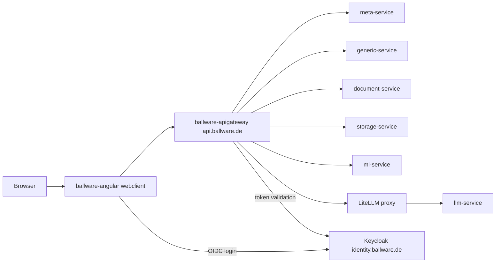

# Architecture

## Big picture

All client traffic goes through the **API gateway**; it is the only public
entry point (`api.ballware.de`).[^1] Individual services are reached directly
only inside a deployment (e.g. `http://localhost:5001` in Docker Compose, or
`<service>.ballware.svc.cluster.local` in the k3s production cluster).[^2]

**Keycloak** issues OAuth2/OIDC tokens (realm `ballware`, audience
`ballwareweb`). The gateway validates bearer tokens against the OIDC authority
and forwards authenticated requests to the backend services.[^1]

## API gateway routes

The gateway is a YARP reverse proxy configured purely declaratively
(routes/clusters/transforms in JSON).[^1] Deny-by-default: a fallback
authorization policy applies; only routes explicitly marked `Anonymous` (or
without a policy) skip authorization.[^1]

| Route | Path match | Cluster / target | Auth |
| --- | --- | --- | --- |
| `meta-api` | `/meta/**` | meta service | required |
| `meta-mcp` | `/meta/mcp/**` | meta service | required (`metaApi`) |
| `meta-anonymous-download` | `GET /meta/{entity}/download/**` | meta service | anonymous |
| `tenant-api` | `/tenant/**` | generic service (tenant API) | required |
| `generic-api` | `/generic/**` | generic service | required |
| `generic-mcp` | `/generic/mcp/**` | generic service | required (`genericApi`) |
| `generic-anonymous-download` | `GET /generic/{application}/{entity}/download/**` | generic service | anonymous |
| `reporting-api` | `/document/**` | document/reporting service | required |
| `reporting-anonymous-download` | `GET /document/{entity}/download/**` | reporting service | anonymous |
| `reporting-app` | `/**` on host `reporting.ballware.de` | Blazor reporting app | anonymous (session-based) |
| `storage-api` | `/storage/**` | storage service | required |
| `storage-anonymous-download` | `GET /storage/attachment/downloadforentityandownerbyid/**` | storage service | anonymous |
| `ml-api` | `/ml/**` | ml service | required |
| `ml-anonymous-download` | `GET /ml/mlmodel/download/**` | ml service | anonymous |
| `ai-signalr` | `GET /ai/hubs/**` (WebSocket upgrade) | llm service | required |
| `ai-chat` | `/ai/v1/responses/**` | LiteLLM proxy | required, claim→key transform |
| `ai-api` | `/ai/{entity}/**` | llm service | required |

Source: `ballware-apigateway/src/Ballware.ApiGateway.Service/appsettings.json`
(routes/clusters) and `ballware-apigateway/README.md` (route map, ranking
behavior).[^1]

### Gateway specifics

- **Tenant/rights claims:** the gateway maps configurable claim names
  (`tenant`, `sub`, `right`) and enforces scopes per surface (`metaApi`,
  `serviceApi`, `genericApi`, …).[^1]
- **`CustomHeaderFromClaim` transform:** copies a JWT claim (e.g. `ai_key`)
  into an outbound header (`x-litellm-api-key`) — used for the LiteLLM chat
  route; 403 if the claim is missing.[^1]
- **`JsonBodyProperty` transform:** injects MCP tool definitions
  (`ballware_meta_mcp`, `ballware_generic_mcp`) into the chat request body for
  the `ai-chat` route.[^1]
- **`AuthorizationTokenHeaderMiddleware`:** for clients that cannot send an
  `Authorization` header (notably MCP clients), a route-specific token header
  is copied into `Authorization: Bearer`.[^1]
- **Access tokens via `access_token` query string** are accepted for
  WebSockets/SSE only.[^1]
- **MCP OAuth metadata (RFC 9728):** the gateway serves
  `/.well-known/oauth-protected-resource` (incl. `/meta/mcp` and
  `/generic/mcp` variants with scopes `metaApi` / `genericApi`).[^1]
- **Anonymous download routes** exist for direct file links (report output,
  attachments, ml models, exports).[^1]

## Internal service addressing

In the production k3s platform the gateway clusters point at in-cluster DNS
names following `<service>.ballware.svc.cluster.local` (e.g.
`ballware-storage-service.ballware.svc.cluster.local`).[^2] In the local
Docker Compose evaluation stack, services are addressed by container name and
port: web 3000, Keycloak 3001/3002, meta 5001, generic 5002, ml 5003,
reporting 5004, storage 5005.[^3]

## Service-to-service calls

Backend services call each other with OAuth2 **client credentials** flows
(the generic service calls meta, storage, and ml; the document service calls
meta, storage, generic, and ml). Service APIs (`/swagger/service`) are the
internal-facing API surfaces.[^2][^4]

## Shared building blocks

`ballware-shared-dotnet` provides the recurring patterns: `Guid tenantId`
on every data call, claim/script-based authorization (`ITenantRightsChecker`,
`IEntityRightsChecker`), a uniform 11-route CRUD API mapping
(`MapTenantableEditingApi` with rights `view|add|edit|delete`), Quartz import
jobs, and MCP server support (`Ballware.Shared.Mcp*`, per-user dynamic
tools).[^4]

[^1]: `ballware-apigateway/README.md`, `ballware-apigateway/src/Ballware.ApiGateway.Service/appsettings.json`
[^2]: `ballware-ansible/playbooks/group_vars/all.yml`, `ballware-ansible/playbooks/roles/ballware-api-gateway/tasks/service.yml`
[^3]: `ballware-docker-compose/README.md`
[^4]: `ballware-shared-dotnet/README.md`, `ballware-generic-service/README.md`, `ballware-document-service/README.md`
